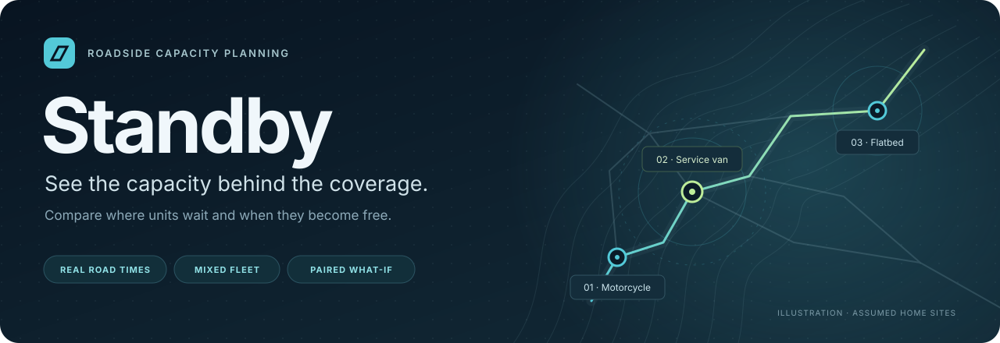
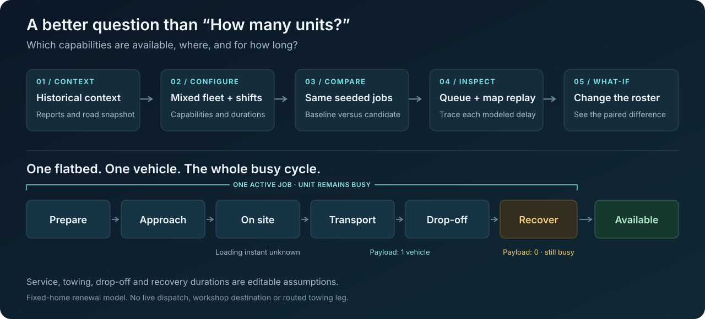
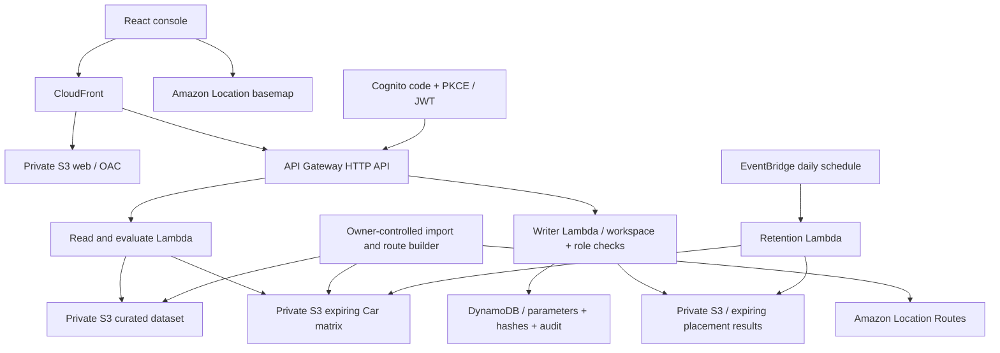

# Standby

**Standby helps a roadside assistance shift planner compare where units wait and how overlapping jobs keep them busy, using prepared AWS road times and explicit scenario assumptions.**

[](https://github.com/upgradedev/standby/actions/workflows/ci.yml?query=branch%3Afeat%2Fcapacity-mvp)
[](#architecture)
[](apps/console/package.json)
[](LICENSE)

**[Open Capacity lab →](https://d34x1513u5u1qs.cloudfront.net/capacity)** · [Explore coverage](https://d34x1513u5u1qs.cloudfront.net/map) · [Data provenance](https://d34x1513u5u1qs.cloudfront.net/api/v1/public/manifest) · [Documentation](#documentation)



Built for [AWS Weekend Challenge: Map it](https://builder.aws.com/build/hackathons/e7a301ea-4d84-3b9e-95be-7340a70f7781/weekend-challenge-map-it). The public console runs without an account. Shared placement-plan writes use a separate authenticated workspace.

## Contents

[The problem](#the-problem) · [Try it](#try-a-scenario) · [Towing](#one-flatbed-one-vehicle-the-whole-cycle) · [Data and assumptions](#real-data-and-visible-assumptions) · [Architecture](#architecture) · [Build and test](#build-and-test) · [Evidence](#evidence-and-release-status) · [Docs](#documentation) · [License](#license-and-attribution)

## The problem

A map can show a nearby flatbed while that flatbed is carrying someone else's car. A shift planner needs to see **compatible, on-duty capacity and the full busy cycle**, alongside geographic reach.

Standby provides a planning console for that pre-shift question. It compares alternatives before a roster or availability change; integration with an operator's existing dispatcher is not connected.

| View | Question it answers | What it computes |
|---|---|---|
| **Coverage map** | Where could a hypothetical fleet wait? | Historical demand coverage over candidate sites using directional Car road times; compare placements and remove a unit. |
| **Capacity lab** | What happens when jobs overlap? | Compatible assignment, queueing, shifts and per-type busy cycles for a mixed fleet. |
| **Paired what-if** | What changes with another unit or different roster? | Baseline and candidate use the same seeded arrivals and service draws; compare modeled outcomes. |

The console also includes historical overview charts, a searchable zone table and detail drawer, placement-plan review queues, and settings. It supports dark/light themes and responsive navigation. The **Planning queues** page manages placement plans; the **modeled job queue** belongs to a Capacity run.

## Try a scenario

1. Open **[Capacity lab](https://d34x1513u5u1qs.cloudfront.net/capacity)** and review **Workload, service profiles and rosters**.
2. Set the workload and configure baseline/candidate motorcycles, service vans and flatbeds: capabilities, home site, availability and duty interval.
3. Choose **Run paired comparison**. Read the response, queue, completion and overtime metrics with their sample counts.
4. Scrub the replay, open a modeled job, and inspect its map, timeline and current unit state. Change a roster assumption and run again.

Changing an input marks the old result stale. The comparison summarizes replications; the replay shows the first replication of the selected fleet plan.

Battery, tyre, breakdown and collision profiles have separate editable service durations. Capability checks keep an incompatible unit from silently absorbing work.



## One flatbed. One vehicle. The whole cycle.

Each flatbed has **one active job and one vehicle slot**. Another compatible job queues until the unit's `availableAgain` time. Completing the modeled drop-off empties the payload; the configured recovery allowance can still keep the unit busy.

Transport and drop-off are editable time allowances. Recovery assumes renewal at the configured home site. Actual workshop destinations, workshop queues, return travel and routed towing legs are not connected. Car-profile approach times are not validated motorcycle or heavy-truck routing.

## Real data and visible assumptions

| Layer | What Standby uses | How to read it |
|---|---|---|
| **Observed** | [City of Austin traffic reports](https://data.austintexas.gov/d/dx9v-zd7x), restricted to stalled-vehicle labels. | Public reports, not an operator's complete assistance demand. Publication time is not confirmed occurrence time. |
| **Derived** | Sanitized zones, representative locations and historical counts. Training uses 2023–2024; 2025 is the later holdout. | Zone locations are approximate. The public API omits raw report IDs, exact customer addresses and free text. |
| **AWS road snapshot** | Prepared, directional Amazon Location **Car** approach times and an AWS basemap. | A traffic-independent snapshot with provenance and expiry, not a live traffic forecast. |
| **Assumed and editable** | Fleet, sites, shifts, incident count/type mix, hourly arrival weights, service durations, transport/drop-off, recovery and travel multiplier. | Inputs for sensitivity analysis, not measured operator parameters or an agreed SLA. |
| **Not connected** | Insured/driver records, vehicle GPS, workshop routing/queues, weather/crowding effects, holiday forecasts and anomaly detection. | No live dispatch or production staffing guarantee. Bedrock, AgentCore, Strands and an AI copilot are not deployed in this MVP. |

**Three units is an editable example, not a claim of sufficient staffing.** Queues depend on workload, capability mix, service-time assumptions and shift availability. Simulation ranges describe variability across the modeled replications, not the full uncertainty in real operations.

The static Coverage fleet is separate from the mixed Capacity roster. Map home markers are assumed standby sites, not current vehicle positions. [Data configuration](tools/data/model-config.json) · [Independent dataset validator](tools/data/validate.py) · [Research and limitations](docs/research/standby-evidence/RESEARCH.md).

## Architecture

**Amazon Location is load-bearing:** the evaluators use its prepared directional road-time snapshot, and the console renders its basemap. Straight-line distance is not substituted when a route or snapshot is unavailable.


<details>
<summary>Architecture source: Mermaid</summary>



</details>

| Boundary | Implemented behavior |
|---|---|
| **Public evaluation** | Bounded, stateless Coverage/Capacity computations over prepared snapshots. Read Lambda has no plan-write, DynamoDB-write or paid-routing permissions. |
| **Shared placement plans** | Cognito JWT plus server-side workspace membership and Analyst/Planner/Admin permissions. Separate Writer Lambda; version checks, idempotent save and exact-result review. Capacity runs are not saved or reviewed as placement plans. |
| **Provider data** | Private route/result cache with application expiry checks, `no-store` API responses and scheduled deletion/absence verification. DynamoDB stores our plan parameters, hashes, references and audit, rather than numerical provider-result payloads. |
| **Paid route generation** | Separate owner-controlled builder and finite route-pair quota. No anonymous endpoint rebuilds a route matrix. Basemap requests and ordinary serverless usage still incur their own costs. |

Infrastructure is **[Python-generated CloudFormation](infra/template.py)**. CloudFront serves the frontend and proxies `/api/*` on the same origin; the HTTP API does not configure cross-origin CORS. The [specification](docs/STANDBY_MVP_SPEC.md#αρχιτεκτονική-aws) documents operational, security, reliability, performance, cost and sustainability tradeoffs. These are design choices with residual gaps, not a certification.

## Build and test

Use **Node.js 22.12 or newer**, npm and Python 3. The lockfile pins the JavaScript dependencies. These commands run source checks and build artifacts; they do not deploy AWS resources or prepare paid routes.

```sh
git clone --branch feat/capacity-mvp https://github.com/upgradedev/standby.git
cd standby
npm ci
npm run check:secrets
npm run typecheck
npm test
npm run build
```

The complete map/evaluation experience is available in the [hosted console](https://d34x1513u5u1qs.cloudfront.net/capacity). A local console needs a compatible `/config.json`, API deployment and prepared data/matrix; private provider snapshots and credentials are not included in this repository. There is no fallback operational dataset.

<details>
<summary>Additional offline data and research checks</summary>

```sh
python -m unittest discover -s tools/data -p "test_*.py"
python docs/research/standby-evidence/retrieve.py --help
python docs/research/standby-evidence/retrieve.py --validate
python docs/research/standby-evidence/verify_retrieval.py
```

The research index retrieves curated source notes and their limitations with lexical ranking. It is a local research utility, not a deployed RAG service or a retrieval-accuracy benchmark. Dataset validation accepts an existing artifact: `python tools/data/validate.py path/to/dataset.json`.

</details>

## Evidence and release status

| Evidence | Scope |
|---|---|
| [Full CI at `ee0faad`](https://github.com/upgradedev/standby/actions/runs/41425724781) | Completed successfully on 2026-11-02: source/build checks, route and towing QA, and offline capture controls. Optional authenticated-role execution is a separate gate. |
| [Post-deployment anonymous acceptance](https://github.com/upgradedev/standby/actions/runs/41200012209) | Actual deployed controlled preview, desktop/tablet/mobile, without a static UI overlay. |
| [Historical authenticated-role acceptance](https://github.com/upgradedev/standby/actions/runs/41181026025) | Cognito/workspace authorization at its recorded earlier source. It is not a new human role-menu judgment. |
| [Current delivery state](STATE.md) | Exact deployment evidence and open items. The final public video for the current Capacity release and final Builder submission remain pending. |

The controlled preview serves frontend **`db67b6d0a2455549736be0d6574c184309fe0277`** and API/config **`3802d94e5ae5a66b6b7fb8fc67030393d0a276ea`** as recorded in the [deployment handover](docs/CONSOLE_BRIEF.md#step6-owner-handover---approved-preview-deployed-2026-10-31). These identify different artifacts. A newer source/tooling CI commit does not imply a new application deployment.

Automated axe, map-pixel and API checks do not constitute whole-app accessibility certification. Human keyboard, native-popup and incomplete-axe judgments remain open in the brief.

## Documentation

| Read | For |
|---|---|
| [MVP specification](docs/STANDBY_MVP_SPEC.md) | Implemented scope first, followed by the labeled original design, data contracts and AWS tradeoffs. |
| [Console brief](docs/CONSOLE_BRIEF.md) | Roles, entities, metrics, assumptions, approved UI and remaining human checks. |
| [Research and evidence](docs/research/standby-evidence/RESEARCH.md) | Market context, location/queueing studies, primary-source notes and limits of transferring their findings. |
| [Research source records](docs/research/standby-evidence/sources.jsonl) | Per-source evidence, access level and limitations. |
| [Current state](STATE.md) · [History](LOG.md) · [Known traps](TRAPS.md) | Delivery status, decisions and retained failure evidence. |
| [Infrastructure](infra/template.py) · [CI](.github/workflows/ci.yml) · [Live acceptance](.github/workflows/live.yml) | Reproducible infrastructure definition and verification paths. |

The original code is organized by responsibility:

```text
apps/console/          React, TypeScript, Tailwind, TanStack Table, MapLibre
packages/contracts/   Shared DTOs, types and model limits
packages/domain/      Coverage solver and seeded capacity simulation
packages/application/ Use cases and ports
services/api/         HTTP, identity, S3, DynamoDB and retention adapters
tools/data/           Import, normalization and independent validation
infra/                CloudFormation generator
tests/browser/        Anonymous/authenticated journeys and map/capture checks
```

## License and attribution

Original application code, documentation and the original SVG diagrams are available under [MIT](LICENSE), copyright © 2026 Efthimios Fousekis. React, TanStack Table, MapLibre and the other dependencies retain their own licenses.

Austin source data remains subject to the [City of Austin Open Data terms](https://datahub.austintexas.gov/stories/s/ranj-cccq). Amazon Location/HERE basemap and route data remain subject to their provider terms and are **excluded from the MIT license and source repository**. The diagrams above are original illustrations and contain no provider route snapshot.

FrontBox layout/table/detail patterns were read as design references; Standby components were implemented separately. No commercial customer data, identities or configuration were copied. Research notes paraphrase and link their sources; they do not redistribute complete papers.
