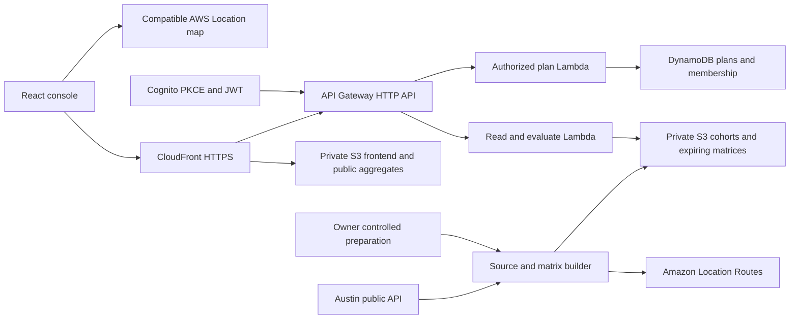

# Standby Operations Console MVP

Το Standby βοηθά τον υπεύθυνο βάρδιας οδικής βοήθειας να συγκρίνει θέσεις αναμονής ενός περιορισμένου στόλου και να βλέπει ποιες περιοχές παραμένουν ακάλυπτες. Η πρώτη έκδοση χρησιμοποιεί πραγματικές αναφορές ακινητοποιημένων οχημάτων στο Austin και σαφώς επισημασμένο υποθετικό στόλο. Το αποτέλεσμα είναι ιστορική αξιολόγηση κάλυψης με μοντελοποιημένους χρόνους οδικής προσέγγισης.

Ο ιδιοκτήτης επέλεξε το προϊόν και το stack React, TypeScript, Tailwind και TanStack Table στις 29 Οκτωβρίου 2026 και ενέκρινε USD 25 συνολικό AWS budget. Η υλοποίηση ξεκινά μετά την επίσημη έναρξη στις 30/10, με σειρά application shell, χάρτης πραγματικών δεδομένων και coverage evaluation. Η προδιαγραφή καλύπτει το MVP, το application shell, τα δεδομένα, τα όρια πρόσβασης, την αρχιτεκτονική AWS, το demo και το χρονοδιάγραμμα παράδοσης. Περιγράφει προγραμματισμένη υλοποίηση, όχι λειτουργίες ήδη σε παραγωγή.

## Απόφαση και όριο του MVP

Ο βασικός κύκλος είναι: επιλογή ιστορικού και βάρδιας, επιθεώρηση υφιστάμενης κάλυψης, υπολογισμός εναλλακτικών θέσεων, σύγκριση, αφαίρεση διαθέσιμης μονάδας και επανυπολογισμός. Ο χρήστης καταλαβαίνει τόσο τη βελτίωση όσο και τα κενά που παραμένουν.

Η πρώτη επαληθευμένη αξιολόγηση χρησιμοποιεί μία γενική κατηγορία τεχνικής βοήθειας με ένα δηλωμένο προφίλ οδικής διαδρομής. Το domain υποστηρίζει τύπο μονάδας και ικανότητες, ώστε μηχανές, service vehicles και πλατφόρμες να μην εξισώνονται. Η πραγματική κατηγορία απαιτούμενης βοήθειας δεν υπάρχει στην πηγή Austin. Ένα μικτό σενάριο στόλου θα φέρει ανεξάρτητη ένδειξη υποθετικής σύνθεσης αναγκών και θα προστεθεί μόνο αφού λειτουργήσει η βασική αξιολόγηση.

| Μέσα στην πρώτη παράδοση | Μελλοντική επέκταση |
|---|---|
| Αναμονή στην αρχή βάρδιας και σενάριο μη διαθέσιμης μονάδας | Συνεχής περιπολία και δυναμική αναδρομολόγηση |
| Ιστορικές αναφορές ακινητοποιημένων οχημάτων | Πρόβλεψη μελλοντικών βλαβών |
| Μικρό διακριτό σύνολο υποθετικών θέσεων αναμονής | Πραγματικές εγκεκριμένες βάσεις εταιρείας |
| Σύγκριση σταθερού στόλου με ίδιο matrix | Διαχείριση ταυτόχρονων εργασιών, ουρών και service duration |
| Ανώνυμη εκτέλεση σεναρίων και ιδιωτική αποθήκευση εξουσιοδοτημένων σχεδίων | Live dispatch, τηλεματική και επικοινωνία με οδηγούς |

Η επιτυχία του MVP κρίνεται από μια επαναλήψιμη δημόσια διαδρομή που εκτελεί τον βασικό υπολογισμό χωρίς λογαριασμό. Δεν απαιτείται να εκθέσουμε εταιρικά δεδομένα ή υπηρεσία πραγματικής ανάθεσης.

## Παραδοτέα και προθεσμίες

Η [πρόκληση AWS Map it](https://builder.aws.com/build/hackathons/e7a301ea-4d84-3b9e-95be-7340a70f7781/weekend-challenge-map-it?tab=rules) δίνει ίσο βάρος σε πρωτοτυπία, εκτέλεση, χρησιμότητα και αφήγηση. Η περίοδος αρχίζει στις 30/10/2026 07:00 UTC, δηλαδή 09:00 Europe/Athens, και λήγει στις 02/11/2026 21:00 UTC, δηλαδή 23:00 Europe/Athens. Η συντηρητική ερμηνεία του build window παραμένει η καταγεγραμμένη απόφαση: προδιαγραφή πριν την έναρξη, κώδικας μετά.

| Παραδοτέο | Κριτήριο ολοκλήρωσης |
|---|---|
| Δημόσια εφαρμογή AWS | Ανώνυμο HTTPS URL, HTTP 200, πραγματικός χάρτης και εκτέλεση σύγκρισης θέσεων |
| Πραγματικά δεδομένα | Πηγή, δικαιώματα, περίοδος, σχήμα, αποκλεισμοί και manifest αναπαράγονται |
| Κώδικας | Νέο αποθετήριο με MIT για τον δικό μας κώδικα και διακριτές άδειες τρίτων δεδομένων |
| Περιγραφή Builder Center | Πρόβλημα, dataset, AWS μηχανισμός, παραδοχές, live URL και video |
| Δημόσιο video | Κάτω από τρία λεπτά, το προϊόν λειτουργεί, δημόσια ορατό στο επιτρεπόμενο hosting |
| Υποβολή | Ορατή κατάσταση Submitted, με ανεξάρτητο έλεγχο συνδέσμων και πρόσβασης |

Δεν προγραμματίζεται αυτόματη συνέχιση στο Codex. Η εξουσιοδότηση υλοποίησης υπάρχει· η επόμενη ενεργή συνεδρία μετά την έναρξη ακολουθεί αυτό το πλάνο χωρίς νέα ερώτηση για το ίδιο scope.

## Πραγματικά δεδομένα και αναπαραγωγή

Πηγή είναι το [City of Austin Real Time Traffic Incident Reports](https://data.austintexas.gov/d/dx9v-zd7x), μέσω του δημόσιου Socrata endpoint `https://data.austintexas.gov/resource/dx9v-zd7x.json`. Τα [metadata](https://data.austintexas.gov/api/views/dx9v-zd7x.json) περιγράφουν το `traffic_report_id` ως αναγνωριστικό αναφοράς, το `published_date` ως χρόνο δημοσίευσης και το status ως active ή archived. Χρόνος δημοσίευσης, χρόνος συμβάντος και χρόνος απόκρισης είναι διαφορετικά στοιχεία.

Οι [όροι Open Data του Austin](https://datahub.austintexas.gov/stories/s/ranj-cccq) επιτρέπουν την επαναχρησιμοποίηση των δεδομένων του portal εκτός ειδικής ένδειξης στα metadata, με περιορισμούς όπως η αποφυγή επαναταυτοποίησης. Η εφαρμογή θα αναφέρει την πηγή και τους μετασχηματισμούς χωρίς να υπονοεί συνεργασία ή έγκριση του Δήμου.

Η προτεινόμενη χρονική διαίρεση κλειδώνει πριν γραφτεί ο optimizer:

| Cohort με UTC publication timestamps | Ρόλος |
|---|---|
| 2023-01-01 inclusive έως 2025-01-01 exclusive | Επιλογή θέσεων και παραμέτρων εκπαίδευσης |
| 2025-01-01 inclusive έως 2026-01-01 exclusive | Μεταγενέστερη αξιολόγηση που δεν επιλέγει το σχέδιο |

Ο coordinator επαλήθευσε ανεξάρτητα ολόκληρα τα περιορισμένα annual cohorts με deterministic order: 1.863 γραμμές/unique IDs για το 2023, 1.593 για το 2024 και 1.662 για το 2025. Αυτοί οι αριθμοί είναι ευρήματα έρευνας και όχι αποθηκευμένο production snapshot. Κατά το import επαναμετρώνται, αποθηκεύονται με hash και συνδέονται με το πραγματικό artifact. Ο Ιανουάριος 2024 φαίνεται ασυνήθιστα αραιός· η εφαρμογή δείχνει κάλυψη αναφορών, χωρίς συμπέρασμα ότι υπήρξαν λιγότερες πραγματικές βλάβες.

Ακριβές query για επαλήθευση κάθε cohort, με URL encoding από τον client:

```text
$select=traffic_report_id,published_date,latitude,longitude,traffic_report_status
$where=issue_reported in ('Stalled Vehicle','zSTALLED VEHICLE') AND published_date >= '2024-01-01T00:00:00Z' AND published_date < '2025-01-01T00:00:00Z'
$order=published_date,traffic_report_id
$limit=10000
```

Το import ολοκληρώνεται με σελιδοποίηση μέχρι το τέλος της πηγής, αντί να θεωρεί αυθαίρετα ότι το όριο της πρώτης απάντησης αποτελεί ολόκληρο το dataset. Αποθηκεύει ιδιωτικά την απάντηση, τα metadata, το exact query, retrieval UTC, SHA256, schema version και καταμέτρηση απορρίψεων.

Η διαδικασία εισαγωγής:

1. Κανονικοποιεί αποκλειστικά τα `Stalled Vehicle` και `zSTALLED VEHICLE` σε μία έννοια. Εξαιρεί ατυχήματα και ιατρικές αναφορές.
2. Ελέγχει μη κενό αναγνωριστικό, έγκυρο UTC timestamp και πεπερασμένες συντεταγμένες WGS84 στην προκαθορισμένη περιοχή.
3. Αφαιρεί πανομοιότυπα διπλότυπα. Συγκρουόμενες εκδόσεις μπαίνουν σε quarantine με αιτία, δεν επιλέγονται σιωπηρά.
4. Παράγει χωριστά train και holdout counts. Τα γραφήματα ωρών χρησιμοποιούν `America/Chicago`, ενώ τα όρια cohorts παραμένουν ρητά UTC.
5. Παράγει δημόσιες συγκεντρωτικές ζώνες και opaque zone IDs. Παραλείπει raw report IDs, ακριβείς διευθύνσεις, ελεύθερο κείμενο και προσωπικά στοιχεία από το API του demo.
6. Δημοσιεύει manifest με τις πηγές, την περίοδο, την ανάλυση ζώνης και τους μετασχηματισμούς. Η μηδενική έγκυρη είσοδος είναι αποτυχία import.

Η γεωγραφική περιοχή, οι ζώνες, οι θέσεις υποψηφίων και το objective κλειδώνουν με version πριν την αξιολόγηση. Προτεινόμενη σταθερή study bounding box WGS84 είναι `[west=-97.88, south=30.18, east=-97.62, north=30.46]`, ως περιορισμένη περιοχή επίδειξης και όχι εταιρική επικράτεια. Το import δημοσιεύει εισερχόμενες/εκτός περιοχής καταμετρήσεις για κάθε cohort.

Τα representative points επιλέγονται αποκλειστικά από τις έγκυρες training θέσεις με deterministic bounded medoid procedure και ελέγχονται για routability πριν κλειδώσουν. Τα fixed Voronoi partitions τους καλύπτουν ολόκληρη τη study περιοχή. Κάθε heldout συμβάν εντός περιοχής αντιστοιχίζεται στον πλησιέστερο ήδη κλειδωμένο representative, ακόμη και αν εκείνη η υποπεριοχή δεν είχε προηγούμενη ζήτηση. Δεν δημιουργεί νέα θέση, δεν περικόπτει τη γεωγραφία και δεν αφαιρείται από τον παρονομαστή. Η απόσταση πραγματικής αναφοράς από representative καταγράφεται ως spatial approximation metric· δεν χρησιμοποιείται για να βελτιστοποιηθεί ξανά το σχέδιο από το holdout. Τα matrix pairs καλύπτουν όλους τους frozen representatives. Έτσι το heldout δεν επιλέγει ζώνες, candidate sites, thresholds ή tie breaks.

## Μοντέλο κάλυψης

Προτείνεται αρχικό bounded μοντέλο με έως 12 υποψήφια σημεία, έως 240 ζώνες ζήτησης και 1 έως 4 διαθέσιμες γενικές μονάδες. Αυτά είναι όρια σχεδιασμού, όχι διαπιστωμένη επιχειρησιακή δυναμικότητα. Η επιλογή συγκεκριμένων συντεταγμένων γίνεται από το training cohort και ελέγχεται στο δίκτυο δρόμων. Οι υποθετικές θέσεις εμφανίζονται ως `Scenario assumed`, μέχρι πραγματικός operator να εγκρίνει πρόσβαση, ωράριο και χωρητικότητα.

Για το μικρό σύνολο θέσεων είναι εφικτή εξαντλητική απαρίθμηση των επιτρεπόμενων συνδυασμών. Η εφαρμογή γράφει «καλύτερο μεταξύ αυτών των θέσεων και περιορισμών» μόνο όταν η απαρίθμηση ολοκληρώνεται. Διαφορετικός solver αναφέρεται με το πραγματικό του όνομα και όριο.

Πρωτεύων στόχος είναι η μέγιστη σταθμισμένη ιστορική ζήτηση εντός του χρόνου που επιλέγει ο χρήστης. Tie break: μικρότερος μοντελοποιημένος χρόνος και σταθερή λεξικογραφική σειρά site IDs. Οι ακριβείς κανόνες μπαίνουν σε versioned domain contract και independent fixture.

Η σύγκριση περιλαμβάνει το αρχικό depot plan και ένα εύλογο γεωγραφικά κατανεμημένο baseline με ίδιο στόλο. Όλα αξιολογούνται με ίδιο matrix και ίδιο holdout. Εμφανίζονται κέρδη και απώλειες ανά ζώνη, όχι μόνο η συνολική ευνοϊκή μεταβολή.

| Μέτρηση | Ακριβής έννοια |
|---|---|
| Coverage | Βάρος ζήτησης που προσεγγίζεται από διαθέσιμη συμβατή μονάδα εντός ορίου, διά όλη την επιλέξιμη ζήτηση |
| P50 και P90 | Σταθμισμένα quantiles μοντελοποιημένου χρόνου οδικής προσέγγισης με δηλωμένο χειρισμό unreachable |
| Uncovered | Καμία μονάδα, μη συμβατή ικανότητα, χωρίς οδική διαδρομή ή υπέρβαση ορίου, με χωριστές αιτίες |
| Backup coverage | Ζήτηση εντός ορίου από δεύτερη ανεξάρτητη διαθέσιμη μονάδα |
| Resilience | Μεταβολή κάλυψης μετά την αφαίρεση επιλεγμένης μονάδας |
| Repositioning | Δηλωμένος χρόνος ή απόσταση μεταξύ αρχικής και προτεινόμενης θέσης |

Τα πραγματικά NoRoute αποτελέσματα διατηρούνται ως unreachable. Έλλειψη κελιών, λάθος μονάδες, ασυμφωνία IDs, άγνωστο provider error και ληγμένο matrix αποτυγχάνουν με σαφή ένδειξη. Κανένα από αυτά δεν γίνεται μηδέν δευτερόλεπτα ή ευθεία απόσταση. Τα μη πεπερασμένα quantiles μεταφέρονται ως διακριτές καταστάσεις συμβολαίου, όχι JSON NaN ή πλασματικός αριθμός.

Η στατική σύγκριση υποθέτει διαθεσιμότητα των μονάδων. Χρόνοι κλήσης, ανάθεσης, προετοιμασίας, εργασίας και ουρών χρειάζονται εταιρικό ιστορικό και ξεχωριστή προσομοίωση. Τα KPIs του demo δεν ονομάζονται πραγματικός χρόνος αναμονής πελάτη ή επιτευγμένο SLA.

## Application shell και πλοήγηση

Η αναφορά FrontBox χρησιμοποιείται για συμπεριφορές και εργονομία. Η νέα υλοποίηση θα είναι πρωτότυπη και δεν θα αντιγράψει πηγαίο κώδικα, πελατειακά fixtures, tenant IDs, authentication configuration ή AWS ρόλους.

| Route | Όνομα πλοήγησης | Σκοπός |
|---|---|---|
| `/overview` | Overview | Κατάσταση επιλεγμένου dataset και σεναρίου |
| `/incidents` | Incident history | Αναζήτηση και επιθεώρηση δημόσιων ζωνών αναφορών |
| `/queues` | Planning queues | Σχέδια προς έλεγχο, σφάλματα μοντέλου και ποιότητα δεδομένων |
| `/map` | Coverage map | Σύγκριση τοποθετήσεων και σενάριο μη διαθέσιμης μονάδας |
| `/settings` | Settings | Προτιμήσεις, στόχοι, προέλευση, δικαιώματα και ρυθμίσεις workspace |

Το sidebar επεκτείνεται ή γίνεται navigation rail. Η κατάστασή του αποθηκεύεται ως έκδοση τοπικής προτίμησης. Labels, ενεργή σελίδα και badges παραμένουν προσβάσιμα με πληκτρολόγιο και screen reader. Οι μετρητές έχουν σαφές scope και επαναϋπολογίζονται από το ίδιο query/scenario state: public zone count στο History, σχέδια του ενεργού store προς review στο Queues και uncovered zones της επιλεγμένης αξιολόγησης στο Map. Μη υπολογισμένο count εμφανίζεται ως unavailable, όχι ως μηδέν. Το rail διατηρεί compact counters και περιγραφές.

Η top bar περιέχει workspace switcher, global search, `/` shortcut, ένδειξη dataset freshness και user menu. Το `/` δεν ενεργοποιείται κατά την πληκτρολόγηση σε input, textarea, select, contenteditable ή dialog και αγνοεί modifier shortcuts. Το Escape κλείνει το ανώτερο ενεργό overlay και επιστρέφει focus. Το user menu έχει πραγματική ταυτότητα/ρόλο, link προφίλ ή τοπικών προτιμήσεων και sign out όταν υπάρχει σύνδεση.

Η global search αναζητά στο πλήρες διαθέσιμο public snapshot ή σε εξουσιοδοτημένα σχέδια/ζώνες του workspace, όχι μόνο στην τρέχουσα σελίδα του πίνακα. Το public adapter επιστρέφει zones/sites και συνενώνει τοπικά σενάρια της συνεδρίας. Το protected workspace search επιστρέφει επιτρεπόμενα saved plans και επιτρεπόμενα public zones/sites. Αποτελέσματα ομαδοποιούνται ανά τύπο, με debounce, ακύρωση παλιότερης κλήσης, ελάχιστο μήκος και δηλωμένο scope. Αλλαγή workspace ακυρώνει pending requests και καθαρίζει selection, search results και caches που ανήκουν στο προηγούμενο workspace.

Στο mobile το sidebar γίνεται πλήρες modal navigation drawer. Ο πίνακας μετατρέπεται σε list cards ή παραμένει μέσα σε οριοθετημένο οριζόντιο scroll. Το detail drawer καλύπτει την οθόνη, ο χάρτης διατηρεί προσβάσιμη εναλλακτική λίστα και τα controls μετακινούνται σε sheet. Στόχοι οπτικού και λειτουργικού ελέγχου: 375, 768 και 1440 CSS px, μαζί με zoom και keyboard navigation.

## Overview

Breadcrumb: workspace, Overview. Η περίοδος dataset, το source snapshot και το scenario εμφανίζονται δίπλα στον τίτλο.

Οι κάρτες δείχνουν επιλέξιμη ζήτηση του cohort, διαθέσιμες υποθετικές μονάδες, μοντελοποιημένη κάλυψη και P90 χρόνου προσέγγισης. Κάθε κάρτα έχει μονάδα, παρονομαστή/περίοδο και κατάσταση unknown/unreachable όπου χρειάζεται. Ο αριθμός αναφορών ζώνης δεν παρουσιάζεται ως live κλήσεις.

Τα δύο γραφήματα είναι:

- Κατανομή δημοσιευμένων αναφορών ανά τοπική ώρα ή ημέρα της εβδομάδας. Κλικ οδηγεί στο αντίστοιχο φίλτρο ιστορικού.
- Σύγκριση baseline και προτεινόμενου σχεδίου ως κατανομή χρόνων ή coverage ανά όριο. Χρησιμοποιεί το ίδιο heldout cohort και matrix.

Τα γραφήματα έχουν προσβάσιμη περιγραφή και ισοδύναμη πινακοποιημένη προβολή. Δεν εμφανίζουν κενές decorative καμπύλες ή επινοημένα KPIs.

## Incident history και detail drawer

Το TanStack Table αναλαμβάνει sorting, filtering, row selection και pagination. Οι στήλες είναι zone ID, περιοχή, train count, evaluation count, source reporting period, modeled travel time, coverage state και data-quality flag. Τα φίλτρα εφαρμόζονται πριν τη σελιδοποίηση και διατηρούνται στο URL.

Κλικ ή Enter/Space σε γραμμή ανοίγει overlay detail drawer χωρίς να χάνεται η σελίδα ή το scroll του master table. Το selected zone βρίσκεται στο URL. Το drawer έχει tabs:

- Summary: δημόσια συγκεντρωτικά στοιχεία και χρονική κατανομή.
- Coverage: baseline/proposal, συμβατή μονάδα και αιτία uncovered.
- Provenance: source, publication-time semantics, aggregation, snapshot/hash και flags.

Focus trap, accessible dialog name, keyboard tabs, Escape, επαναφορά focus στη γραμμή και browser back αποτελούν acceptance criteria. Λάθος ταυτότητα απάντησης, αλλαγή workspace ή request race δεν αφήνουν παλιό detail να εκτελέσει ενέργεια.

## Planning queues

Οι ουρές αφορούν σχέδια και θέματα ποιότητας. Η πηγή ARCHIVED δεν μετατρέπεται σε «ολοκληρωμένη οδική βοήθεια».

Το αποθηκευμένο σενάριο έχει ξεχωριστά `evaluationStatus = NOT_RUN | SUCCEEDED | FAILED` και `reviewStatus = NOT_READY | NEEDS_REVIEW | REVIEWED`. Το Computing είναι μόνο η κατάσταση πραγματικού in-flight request στον client, δεν παραμένει ως μόνιμη εργασία αν κλείσει το tab. Σε μικρή σύγχρονη αξιολόγηση δεν χρειάζεται υποδομή message queue μόνο για να υπάρχει σελίδα με αυτό το όνομα.

Public queues διαβάζουν μόνο το τοπικό versioned scenario store της συσκευής, με ορατή ένδειξη Local scenarios. Authenticated queues διαβάζουν μόνο DynamoDB plans του ενεργού workspace. Καρτέλες: Draft, Needs review, Reviewed και Failed. Αλλαγή inputs επαναφέρει NOT_RUN/NOT_READY. Η επιτυχής αξιολόγηση δημιουργεί SUCCEEDED/NEEDS_REVIEW· η αποτυχία FAILED/NOT_READY με request ID. Review επιτρέπεται μόνο σε SUCCEEDED αποτέλεσμα, από εξουσιοδοτημένο admin, με το ακριβές input/result/config hash και expected version. Νέα αξιολόγηση ακυρώνει προηγούμενο review. Η ενέργεια δεν ονομάζεται dispatch ή εφαρμογή σε πραγματικό στόλο.

Τα counts προέρχονται από το ίδιο ενεργό store. Κάθε failure έχει αιτία και retry που ξεκινά πραγματικό νέο αίτημα. Το protected evaluate endpoint υπολογίζει και αποθηκεύει ο ίδιος το trusted αποτέλεσμα ή την πραγματική αποτυχία· ο client δεν μπορεί να αποθηκεύσει επινοημένο KPI ως server evidence. Πραγματικά άδεια ουρά εμφανίζει empty state με ενέργεια δημιουργίας σεναρίου. Δεν δημιουργούνται ψεύτικες εργασίες για να γεμίσει η οθόνη.

## Coverage map

Ο βασικός χάρτης χρησιμοποιεί συμβατό AWS Location basemap και τις απαιτούμενες αναφορές παρόχου. Layers: ιστορική ζήτηση, υποθετικές θέσεις, επιλεγμένες μονάδες, covered/uncovered ζώνες και διαφορά από baseline. Το χρώμα συνοδεύεται από legend, labels και σύμβολα.

Controls: period/cohort, fleet size, threshold, baseline/proposal, selected zone και επιλογή μονάδας που γίνεται unavailable. Αλλαγή inputs ακυρώνει ή απορρίπτει παλιότερο αποτέλεσμα. Η εφαρμογή εμφανίζει αμέσως ποιο αποτέλεσμα είναι stale μέχρι τον υπολογισμό του νέου.

Τα coverage polygons δεν σχεδιάζονται ως κύκλοι ευθείας απόστασης. Η πρώτη έκδοση μπορεί να χρωματίζει τις πραγματικές συγκεντρωτικές ζώνες με βάση τον οδικό χρόνο προς το δηλωμένο representative point. Η χωρική προσέγγιση παραμένει ορατή.

## States και αποτελέσματα ενεργειών

Κάθε route υλοποιεί loading, ready, empty, error και forbidden όπου εφαρμόζεται. Το κοινό PageState αποτρέπει διαφορετικές ερμηνείες των ίδιων καταστάσεων.

| Κατάσταση | Συμπεριφορά |
|---|---|
| Loading | Skeleton στη θέση του πραγματικού περιεχομένου, aria busy, χωρίς αυθαίρετη καθυστέρηση |
| Empty | Εξήγηση του scope και χρήσιμη ενέργεια όπως clear filters ή create scenario |
| Error | Διατηρημένα inputs, αιτία σε κατανοητή γλώσσα, request ID και retry |
| API unavailable | Global alert banner με πραγματική επίδραση: αποτυχία φόρτωσης, υπολογισμού ή αποθήκευσης |
| Stale data | Ορατό τελευταίο επιτυχές αποτέλεσμα με timestamp και απενεργοποίηση εξαρτώμενων ενεργειών |
| Forbidden | Σαφής περιορισμός ρόλου χωρίς διαρροή εγγραφής άλλου workspace |

Toasts εμφανίζονται μόνο μετά από πραγματική επιτυχία ή αποτυχία ενέργειας. Η επιτυχία αποθήκευσης απαιτεί επιβεβαιωμένη απάντηση server. Ένα τοπικό public σενάριο αποθηκεύει μόνο δικές μας παραμέτρους και references, γράφει «αποθηκεύτηκε σε αυτή τη συσκευή» και δεν υπονοεί cloud persistence. Τα provider-derived αριθμητικά αποτελέσματα δεν μένουν στο local storage· μετά από reload υπολογίζονται με νέο έλεγχο freshness. Τα σημαντικά σφάλματα δεν βασίζονται αποκλειστικά σε toast.

## Settings

Οι τοπικές προτιμήσεις είναι μονάδες απόστασης, timezone προβολής, μέγεθος σελίδας, sidebar state και τελευταία επιλεγμένα layers. Αποθηκεύονται σε versioned browser storage με validation. Save, reset to defaults και reload έχουν ορατό αποτέλεσμα και δεν γράφουν στο κοινό workspace.

Η διαμόρφωση workspace περιλαμβάνει default time threshold, μέγιστο fleet size εντός του published model bound και enabled site IDs από το ήδη υπολογισμένο candidate set. Μόνο Admin μπορεί να την αλλάξει μέσω protected API, με expected version, runtime validation και audit. Οι συντεταγμένες νέων θέσεων και νέα route profiles απαιτούν owner-controlled matrix generation και παραμένουν read-only εδώ. Αλλαγή config version καθιστά παλιό result/review stale· η επόμενη αξιολόγηση πρέπει να χρησιμοποιήσει τη νέα έκδοση.

Τα source period, source/matrix hashes, provider, expiry, release identifier και διαθέσιμα model limits είναι read-only. Roles/memberships είναι owner-managed στο MVP και εμφανίζονται μόνο στους επιτρεπόμενους χρήστες. Το Settings UI δεν αλλάζει τα δικαιώματα μέσω browser role selector. Public simulator βλέπει local preferences και read-only source/model information.

Save χρησιμοποιεί μόνο πραγματική server acknowledgement για shared settings. Version conflict διατηρεί τις αλλαγές του χρήστη και προσφέρει reload/compare. Forbidden και unavailable είναι διαφορετικές καταστάσεις. Δεν ζητάμε ή εμφανίζουμε AWS secrets στο UI.

## Dark theme και design tokens

Η οπτική κατεύθυνση είναι λιτή operations console: σκοτεινή επιφάνεια, καθαρές γραμμές δεδομένων, ψυχρό accent για ενέργειες και διακριτά semantic χρώματα κατάστασης. Τα ακόλουθα είναι αρχική σχεδιαστική πρόταση και θα ελεγχθούν ως προς contrast στην υλοποίηση.

| Token | Αρχική τιμή ή χρήση |
|---|---|
| canvas | `#0B1018` |
| surface | `#111A27` |
| surface raised | `#182438` |
| border | `#2A3A50` |
| text primary | `#E8EFF8` |
| text secondary | `#A7B6C9` |
| accent | `#53C9D8` |
| success / warning / danger | `#76D6A7` / `#F2C66D` / `#F58B91` |
| focus ring | Ορατό accent outline με σταθερό offset |
| spacing | Βάση 4 px, κλίμακα 4/8/12/16/24/32 |
| radii | 8 px controls, 12 px bounded panels |
| shell | 256 px sidebar, 64 px rail, 64 px top bar |
| typography | System sans, tabular numeric figures, ευανάγνωστα table cells |
| motion | Σύντομες μεταβάσεις και σεβασμός prefers reduced motion |

Τα Tailwind utilities συνδέονται με semantic CSS variables. Οι σελίδες δεν εισάγουν ανεξάρτητες αποχρώσεις για τις ίδιες έννοιες. Τα status συνδυάζουν κείμενο και εικονίδιο ώστε να διαβάζονται χωρίς διάκριση χρώματος.

## Roles και workspaces

| Ρόλος | Πρόσβαση |
|---|---|
| Public simulator | Ανώνυμη εξερεύνηση δημοσίων cohorts και προσωρινά προσωπικά σενάρια |
| Analyst | Ανάγνωση επιτρεπόμενου workspace, ιστορικού και αποθηκευμένων συγκρίσεων |
| Planner | Δημιουργία και αποθήκευση σχεδίων στο δικό του workspace |
| Admin | Ρυθμίσεις επιτρεπόμενων θέσεων/στόχων και review σχεδίων του workspace |

Τα μενού αποτυπώνουν τα δικαιώματα που επιστρέφει ο server. Απευθείας πρόσβαση σε URL/API ελέγχεται ανεξάρτητα. Το workspace switcher δείχνει μόνο memberships από αξιόπιστη πηγή. Ο ρόλος και το workspace του browser δεν αποτελούν αποδεικτικό πρόσβασης.

Η σύνδεση γίνεται με Cognito public SPA client, authorization code και PKCE. Το HTTP API JWT authorizer ελέγχει issuer/audience/scopes. Οι protected handlers ελέγχουν access token, groups και workspace membership. Η απόκρυψη κουμπιού δεν αντικαθιστά τον server έλεγχο. [JWT authorization](https://docs.aws.amazon.com/apigateway/latest/developerguide/http-api-jwt-authorizer.html).

## Αρχιτεκτονική AWS

Η εφαρμογή είναι serverless modular monolith με καθαρό κοινό domain και ξεχωριστά IAM όρια. Οι υπηρεσίες επιλέγονται για συγκεκριμένη ευθύνη, με μικρό πλήθος operational moving parts.



| Υπηρεσία | Συγκεκριμένη ευθύνη |
|---|---|
| S3 | Ξεχωριστά buckets για web/public aggregates, private source/cohorts και ιδιωτικό προσωρινό route cache |
| CloudFront | HTTPS, συμπίεση, caching immutable assets, response security headers και OAC πρόσβαση στο S3 |
| API Gateway HTTP API | Versioned routes, JWT authorization protected λειτουργιών, CORS και throttle targets |
| Read and evaluate Lambda | Ανάγνωση δημοσίων δεδομένων και bounded stateless υπολογισμός πάνω σε ιδιωτικό matrix |
| Authorized plan Lambda | Workspace-bound αποθήκευση/review με version checks και audit |
| Owner controlled builder | Εισαγωγή πηγής και πεπερασμένη παραγωγή επιτρεπόμενων matrices |
| Route cache retention worker | Μικρή delete-only Lambda με ημερήσιο EventBridge trigger για την επιβεβαιωμένη λήξη προσωρινών provider artifacts |
| Amazon Location | Πραγματικοί directional route times και συμβατός basemap |
| DynamoDB on demand | Δικές μας παράμετροι σχεδίων, references/hashes αποτελεσμάτων, membership, version checks, idempotency και audit |
| Cognito | Πραγματική ταυτότητα και ρόλοι operator |
| CloudWatch | Structured logs, request IDs, latency/errors/throttles και alarms |
| SAM και CloudFormation | Αναπαραγώγιμη υποδομή και έλεγχος αλλαγών |

Ο ανώνυμος κριτής εκτελεί τον differentiator μέσω bounded evaluation endpoint χωρίς λογαριασμό. Ο evaluator έχει μόνο τις απαιτούμενες αναγνώσεις S3 και δεν κατέχει δικαιώματα αποθήκευσης σχεδίων ή παραγωγής νέων route matrices. Επιστρέφει αποτελέσματα κάλυψης και στοιχεία προέλευσης, χωρίς μαζική διάθεση του ιδιωτικού raw matrix. Οι προσωρινές επιλογές του επισκέπτη παραμένουν απομονωμένες στη δική του συνεδρία.

Ο writer κατέχει τα αναγκαία δικαιώματα DynamoDB για εξουσιοδοτημένα workspace operations, περιορισμένο S3 GetObject στα curated cohorts/matrices και PutObject μόνο στο ιδιωτικό workspace result-cache prefix. Το protected evaluate use case χρησιμοποιεί το ίδιο domain, υπολογίζει στον server και αποθηκεύει ο ίδιος τα αριθμητικά αποτελέσματα στο προσωρινό cache και references/hashes στο plan record. Δεν εμπιστεύεται υποβληθείσες αριθμητικές μετρήσεις του browser. Ο builder έχει ξεχωριστό ρόλο και δεν εκτίθεται ως δημόσιο endpoint. Η σύγχρονη άδεια route matrix είναι `geo-routes:CalculateRouteMatrix` με provider resource, όπως ορίζει το [AWS service authorization reference](https://docs.aws.amazon.com/service-authorization/latest/reference/list_geo-routes.html).

Το web bucket έχει Block Public Access, bucket owner enforced και OAC με signing always. Η policy επιτρέπει στο συγκεκριμένο CloudFront distribution μόνο web/public assets. Τα raw source και route-cache buckets δεν είναι CloudFront origins και δεν επιτρέπουν CloudFront principal. Ο evaluator διαβάζει μόνο curated cohorts και route cache, ποτέ raw imports. Το `/api/*` δεν κρύβεται πίσω από SPA fallback ή κοινό cache. Ένα API/data 404 παραμένει σφάλμα. [OAC](https://docs.aws.amazon.com/AmazonCloudFront/latest/DeveloperGuide/private-content-restricting-access-to-s3.html).

Η πρώτη έκδοση δεν χρειάζεται VPC ή NAT για τις συγκεκριμένες προσβάσεις. Χρησιμοποιεί τους υποστηριζόμενους περιφερειακούς serverless endpoints και scoped IAM. Το runtime και οι εξαρτήσεις καρφιτσώνονται κατά την έναρξη από τις επίσημες διανομές και το hosted lockfile/build.

## API και domain contracts

| Endpoint | Πρόσβαση και συμπεριφορά |
|---|---|
| `GET /v1/public/manifest` | Dataset/matrix metadata, release, periods, bounds και freshness |
| `GET /v1/public/zones` | Bounded filters/sort/cursor, δημόσια συγκεντρωτικά στοιχεία |
| `GET /v1/public/zones/{id}` | Συνεπές detail χωρίς source IDs/addresses |
| `GET /v1/public/search` | Αναζήτηση σε όλο το bounded public snapshot με δηλωμένο scope |
| `POST /v1/public/evaluations` | Strict allowlisted inputs, πραγματικός bounded υπολογισμός, κανένα paid route lookup |
| `GET /v1/workspaces` | Memberships συνδεδεμένου χρήστη |
| `GET /v1/workspaces/{id}/plans` | Workspace-scoped list με role check |
| `GET /v1/workspaces/{id}/plans/{planId}` | Plan metadata και μόνο μη ληγμένο αποτέλεσμα, με workspace check |
| `POST /v1/workspaces/{id}/plans` | Planner/admin, idempotency key και expected version |
| `POST /v1/workspaces/{id}/plans/{planId}/evaluate` | Planner/admin, server υπολογισμός και conditional αποθήκευση πραγματικού αποτελέσματος ή failure |
| `POST /v1/workspaces/{id}/plans/{planId}/review` | Admin, ακριβές input/result hash και audit |
| `GET /v1/workspaces/{id}/search` | Protected search επιτρεπόμενων plans, zones και sites |
| `GET /v1/workspaces/{id}/settings` | Authorised workspace configuration και version |
| `PATCH /v1/workspaces/{id}/settings` | Admin, validated bounded defaults/enabled sites, expected version και audit |
| `GET /v1/health` | Πραγματική ετοιμότητα απαιτούμενων datasets/matrix, χωρίς μυστικά |

Οι DTOs ελέγχονται runtime στα σύνορα. Σφάλματα επιστρέφουν code, message, requestId και retryable. Validation, expired matrix, forbidden, version conflict και upstream unavailable έχουν διαφορετική έννοια. Οι query παράμετροι δεν γίνονται arbitrary SQL, εξωτερικά URLs ή ανεξέλεγκτες συντεταγμένες προς AWS.

Βασικές έννοιες: SourceSnapshot, IncidentCohort, DemandZone, StandbySite, FleetUnit, MatrixSnapshot, StandbyScenario και CoverageResult. Τα αποτελέσματα περιλαμβάνουν dataset hash, matrix hash, solver version, input hash, evaluation period και assumptions.

Ελάχιστα ports: CohortRepository, MatrixRepository, ScenarioRepository και Clock. Το domain δεν εισάγει React, AWS SDK, HTTP ή DynamoDB. Οι pure functions εφαρμόζουν τις invariants. Δεν απαιτείται interface ή service class για κάθε helper.

```text
apps/console/          shell, routes, components, hooks, API adapters
packages/domain/      coverage rules, placement solver, invariants
packages/application/ evaluate and compare use cases, ports
packages/contracts/   validated DTOs and error contracts
services/api/         HTTP, identity, S3 and DynamoDB adapters
tools/data/           source normalization and owner-only matrix preparation
infra/                SAM and CloudFormation
tests/                independent fixtures and end-to-end journeys
docs/                 this specification and source references
```

## Κόστος και όροι route data

Η κύρια προστασία κόστους είναι ότι κανένας ανώνυμος χρήστης δεν δημιουργεί νέες χρεώσιμες route pairs. Ο builder δέχεται μόνο περιορισμένο σύνολο candidates, zones και profiles, ελέγχει εκ των προτέρων τον αριθμό origin × destination και εφαρμόζει ατομικό quota πριν από κλήση. Τα [route matrices χρεώνονται ανά ζεύγος](https://docs.aws.amazon.com/location/latest/APIReference/API_CalculateRouteMatrix.html), όχι μόνο ανά request.

Το quota ledger είναι ξεχωριστό DynamoDB control table, απρόσιτο από public evaluator και plan writer. Μια conditional transaction μειώνει remaining pairs και δημιουργεί μοναδικό reservation για job hash και attempt πριν από κάθε πραγματικό call, μαζί με retry. Ο builder διαθέτει μόνο τα απαιτούμενα control-item permissions. Αμφίβολη έκβαση μετά από timeout δεν επιστρέφει αυτόματα quota ούτε επαναλαμβάνει απεριόριστα την κλήση. Η συμφιλίωση κρατά receipt και χρέωση απόπειρας.

Προτεινόμενο αρχικό όριο είναι 12 × 240 = 2.880 route pairs για ένα profile/snapshot, με συνολικό αρχικό quota 8.640 pairs που περιλαμβάνει όλες τις απόπειρες. Κάθε πρόσθετο profile ή snapshot δεσμεύει quota και εμφανίζεται στην cost estimate. Στις 29/10 επαληθεύτηκαν με `aws pricing get-products --profile default --region us-east-1 --service-code AmazonLocationService --filters Type=TERM_MATCH,Field=regionCode,Value=eu-west-1` οι τιμές Core USD 0.0005/pair, Advanced USD 0.0015/pair και default map tiles USD 0.00004/tile. Ένα Core matrix αυτού του μέγιστου μεγέθους εκτιμάται USD 1.44· το συνολικό Core pair quota USD 4.32. Ενδεικτική κίνηση 100.000 tiles προσθέτει USD 4.00. Οι αριθμοί κόστους είναι ESTIMATES με τις παραπάνω παραμέτρους, πριν από φόρους/free allowances.

Ο ιδιοκτήτης ενέκρινε στις 29/10 **USD 25 συνολικό AWS budget** για το προδιαγεγραμμένο scope έως το δημοσιευμένο τέλος αξιολόγησης. Η αρχική εσωτερική κατανομή στοχεύει USD 10 για Location με Core routing, μέσα στο συνολικό όριο. Πριν από κάθε paid allocation ελέγχονται πραγματική τιμολόγηση, υπόλοιπο και quotas· δεν απαιτείται νέα έγκριση για αμετάβλητη εργασία εντός του εγκεκριμένου ορίου. Υπέρβαση ή παράταση δεσμεύσεων χρειάζεται νέα εξουσιοδότηση. API Gateway throttles, reserved concurrency, bounded payloads και alarms περιορίζουν έκθεση, αλλά δεν παρουσιάζονται ως εγγυημένο χρηματικό όριο. [Throttle semantics](https://docs.aws.amazon.com/apigateway/latest/developerguide/http-api-throttling.html).

Σύμφωνα με τους [AWS Service Terms για Amazon Location](https://aws.amazon.com/service-terms/), HERE/Esri route-result caching έχει χρονικό όριο έως 30 ημέρες και provider-specific περιορισμούς. Επιλέγεται HERE/default με συμβατό AWS/HERE basemap και επαλήθευση provider στο build. Το matrix κρατά provider, generatedAt, expiresAt και attribution, βρίσκεται εκτός MIT source repo και απορρίπτεται από την εφαρμογή όταν λήξει. Η ακριβής λήξη ελέγχεται στον κώδικα· [DynamoDB TTL](https://docs.aws.amazon.com/amazondynamodb/latest/developerguide/TTL.html) και S3 lifecycle δεν είναι μηχανισμοί ακριβούς εξουσιοδότησης χρόνου.

Το route/result-cache bucket είναι unversioned και αποκλείεται από backups, exports, CI artifacts και evidence bundles. Provider-derived matrices, individual times και result payloads ακολουθούν την ίδια λήξη. Το DynamoDB διατηρεί μόνο δικές μας παραμέτρους, έκδοση, hashes και cache references· τα αριθμητικά provider-derived αποτελέσματα δεν αντιγράφονται σε PITR backups. Evaluation responses έχουν no-store, logs/traces δεν καταγράφουν σώματα matrix/result και client memory cache απορρίπτει ληγμένα αποτελέσματα.

Εσωτερική λήξη ορίζεται νωρίτερα από το provider maximum, με αρχικό στόχο την 28η ημέρα. Ο ημερήσιος delete-only retention worker διαγράφει τα ληγμένα αντικείμενα, επαληθεύει απουσία και παράγει alarm σε αποτυχία. Το lifecycle λειτουργεί ως επιπλέον καθαρισμός, όχι ακριβής εγγύηση. Αν η υπηρεσία χρειάζεται να συνεχίσει, αντικαθίσταται πρώτα το ενεργό matrix με νόμιμα ανανεωμένο snapshot· η διατήρηση live εφαρμογής δεν παρατείνει το δικαίωμα κράτησης παλιών provider δεδομένων. Παλιό saved plan με ληγμένο result ζητά επανυπολογισμό και νέο review.

Το frontend map credential, αν απαιτείται, περιορίζεται στις αναγκαίες map ενέργειες, origins και διάρκεια. Δεν δίνει routing ή management δικαιώματα. Η αναφορά origin δεν θεωρείται πλήρες όριο κόστους ή ταυτότητας.

## Well Architected και πρακτικές υλοποίησης

Η εφαρμογή ακολουθεί τις πρακτικές του [Serverless Applications Lens](https://docs.aws.amazon.com/wellarchitected/latest/serverless-applications-lens/welcome.html), με καταγεγραμμένα υπολειπόμενα κενά αντί γενικής δήλωσης πιστοποίησης.

| Πυλώνας | Εφαρμογή στο MVP | Υπολειπόμενο όριο |
|---|---|---|
| Operational excellence | IaC, versioned manifests, release identifier, alarms, rollback runbook | Πραγματική on-call άσκηση δεν αποτελεί μέρος του hackathon |
| Security | Ξεχωριστοί read/write/builder ρόλοι, JWT, workspace checks, ιδιωτικό origin, strict DTOs | Production customer onboarding και penetration assessment χρειάζονται επόμενο κύκλο |
| Reliability | Immutable datasets, idempotent writes, optimistic concurrency, bounded retries, fail on expired/invalid matrix | Περιφερειακή ανάκαμψη μέσω redeploy, όχι ενεργό multi-region |
| Performance efficiency | Μικρό σύνολο, ακριβές bounded solve, client query cache, lazy map load, compressed assets | Τα όρια απόδοσης πρέπει να μετρηθούν στο CI και στο live MVP |
| Cost optimization | Πεπερασμένο matrix preparation, cache με λήξη, no anonymous paid routing, on-demand persistence | Πραγματική κατανάλωση και δημόσια ζήτηση παραμένουν μεταβλητές |
| Sustainability | Επαναχρησιμοποίηση επιτρεπόμενων snapshots, μικρά payloads, περιορισμένοι υπολογισμοί | Δεν προβάλλεται μη μετρημένος ισχυρισμός εξοικονόμησης εκπομπών |

Clean Architecture και DDD ορίζουν ownership στα source history, coverage planning και access/persistence. SOLID εφαρμόζεται στα εξωτερικά adapters και τις ευθύνες. DRY διατηρεί έναν υπολογισμό κάλυψης, ένα permission model και κοινά contracts. KISS και YAGNI κρατούν τον πυρήνα σύγχρονο και bounded. Πρόσθετη orchestration εισάγεται όταν υπάρχει μετρημένη ανάγκη retry/long-running job.

## Έλεγχοι αποδοχής

### Domain και δεδομένα

- Τα δύο source labels κανονικοποιούνται, άσχετα περιστατικά αποκλείονται και conflicting duplicates καταγράφονται.
- UTC και Chicago DST δεν μετακινούν το όριο train/holdout ούτε μπερδεύουν publication και occurrence time.
- Invalid coordinates, empty cohort και malformed/expired matrix αποτυγχάνουν ορατά.
- Μικρό ασύμμετρο matrix fixture δίνει χειροϋπολογισμένη κάλυψη και γνωστό optimum. Αντιστροφή origin/destination αποτυγχάνει τον έλεγχο.
- Busy, incompatible και duplicated units δεν δημιουργούν πλασματική κάλυψη. Empty fleet έχει σωστή αιτιολόγηση.
- Μεταβολή του holdout δεν αλλάζει το σχέδιο που επέλεξε ο training solver.
- Παρονομαστές, unreachable quantiles και μονάδες χρόνου ελέγχονται ανεξάρτητα από την υλοποίηση.

### API και πρόσβαση

- Anonymous, analyst και cross-workspace write αιτήματα απορρίπτονται πραγματικά από τον server.
- Planner μπορεί να αποθηκεύσει μόνο εξουσιοδοτημένο workspace plan. Conflict version δεν καταγράφεται ως επιτυχία.
- Duplicate idempotency key με ίδια/διαφορετικά bytes έχει ρητή συμπεριφορά.
- Public evaluator δεν μπορεί να γράψει σχέδιο, να εκτελέσει builder ή να περάσει αυθαίρετες συντεταγμένες στο AWS.
- Ο writer απορρίπτει forged KPIs/result hashes και αποθηκεύει μόνο δικό του υπολογισμό. Budget reservation με ταυτόχρονα attempts δεν υπερβαίνει το δεσμευμένο pair quota.
- Γνωστά raw-source/matrix paths απορρίπτονται τόσο απευθείας στο S3 όσο και μέσω CloudFront. Η retention δοκιμή επαληθεύει διαγραφή μόνο στο ειδικό cache bucket.
- API outage/timeout/429/503 παράγουν σωστό banner, retry και διατηρημένα inputs χωρίς fake fallback.

### Browser και παράδοση

- Ανώνυμος χρήστης ανοίγει Overview, κάνει drill από chart, φιλτράρει/ταξινομεί/σελιδοποιεί, ανοίγει drawer, συγκρίνει χάρτη και αφαιρεί μονάδα.
- Global search βρίσκει εγγραφή εκτός της τρέχουσας σελίδας και το `/` αγνοείται σε editable fields.
- Workspace switch ακυρώνει pending requests, κλείνει προηγούμενο drawer και δεν εμφανίζει αποτελέσματα ή counts άλλου workspace.
- Expanded sidebar και navigation rail έχουν σωστά entity/scope badges, με unavailable αντί πλασματικού μηδενός.
- Role-based menus συμφωνούν με το API, ενώ direct protected-route πρόσβαση χωρίς το αντίστοιχο δικαίωμα απορρίπτεται.
- Public local queue και authenticated workspace queue διατηρούν ξεχωριστή προέλευση· φίλτρα, retry, review και reload εφαρμόζουν το ορισμένο state contract.
- Settings local save/reset και protected save/reload/version conflict/forbidden συμπεριφέρονται όπως ορίζεται. Δεν αλλάζουν role ή route coordinates από τον browser.
- Drawer, tabs, mobile navigation και user menu λειτουργούν με keyboard και επιστρέφουν focus.
- Από κάθε route είναι διαθέσιμη πλήρης mobile πλοήγηση, global search και κλείσιμο overlay.
- Loading, empty και error κατάσταση κάθε route ελέγχεται με ελεγχόμενο πραγματικό response, όχι αυθαίρετο timer.
- Η δημόσια υπηρεσία επιστρέφει HTTP 200 από καθαρή συνεδρία, ενώ το άμεσο S3 origin δεν δίνει anonymous read.
- Το live release identifier συμφωνεί με το commit του video. Secret scan, typecheck, build, domain/API tests και βασικό browser journey περνούν στο hosted CI.
- Τουλάχιστον ένα σκόπιμα κατεστραμμένο input αποδεικνύει ότι ο gate αποτυγχάνει. Οι έλεγχοι δεν χαλαρώνουν για να περάσει το build.

Εγκαταστάσεις, build και browser dependencies τρέχουν σε hosted CI. Το τοπικό C: έχει περιορισμένο χώρο· δεν δημιουργείται node_modules. Τα snippets και fixtures της νέας εφαρμογής δεν αντιγράφουν εμπορικά δεδομένα ή κώδικα FrontBox.

## Χρονοδιάγραμμα Europe Athens

Τα ακόλουθα είναι στόχοι παράδοσης και εκτίμηση προγραμματισμού. Η ακριβής έκταση περιορίζεται από τα λειτουργικά gates, όχι από την επιθυμία να προστεθούν υπηρεσίες.

| Ημερομηνία και ώρα | Gate |
|---|---|
| 29/10 πριν την έναρξη | Οριστική προδιαγραφή, IA, source contracts, FrontBox pattern review, πρόσβαση λογαριασμών |
| 30/10 09:00 | Έναρξη νέου source repo και παράλληλων απομονωμένων lanes: console, data/domain, AWS |
| 30/10 12:00 | Frozen source/region/split manifest και bounded matrix plan |
| 30/10 16:00 | Πρώτο ανώνυμο HTTPS URL με shell, πραγματικά δεδομένα και χάρτη |
| 30/10 21:00 | Baseline/proposal επανυπολογισμός, unavailable-unit σενάριο, πρώτος end-to-end έλεγχος· έναρξη video production backstop |
| 31/10 15:00 | Όλες οι ζητημένες σελίδες/states, permissions, responsive και data/model audit |
| 31/10 18:00 | Freeze release commit, επαλήθευση live identifier και έναρξη εγγραφής |
| 01/11 12:00 | Δημόσιο video και ολοκληρωμένη περιγραφή με ακριβείς ισχυρισμούς |
| 01/11 18:00 | Υποβολή και έλεγχος ορατής κατάστασης Submitted |
| 01/11 23:00 | Τελικό εσωτερικό backstop υποβολής |
| 02/11 έως 23:00 | Μόνο διορθώσεις υποχρεωτικού παραδοτέου, ψευδούς ισχυρισμού ή κανόνα |

Αν στο πρώτο λειτουργικό gate λείπει έγκυρο AWS matrix, η αποκατάστασή του προηγείται επιπλέον UI. Αν ο πυρήνας λειτουργεί αλλά καθυστερεί επιπλέον μικτό fleet scenario ή πλούσια settings, παραμένουν τεκμηριωμένη επόμενη έκδοση. Η λειτουργική Cognito πρόσβαση, τα server permissions, οι πέντε βασικές σελίδες και οι καταστάσεις τους παραμένουν μέρος της συμφωνημένης κονσόλας.

Η υπηρεσία παραμένει διαθέσιμη σε όλη την περίοδο αξιολόγησης. Το matrix παράγεται ώστε η επιτρεπόμενη διάρκεια χρήσης του να καλύπτει την περίοδο. Δεν εκτελείται teardown βάσει παλιάς ημερομηνίας χωρίς επαλήθευση διοργανωτή και εξαρτήσεων.

## Demo περίπου δυόμισι λεπτών

| Διάστημα στόχος | Εικόνα και μήνυμα |
|---|---|
| 0:00 έως 0:20 | Overview: υπεύθυνος βάρδιας, συγκεκριμένος στόλος, πραγματικό Austin ιστορικό και scope |
| 0:20 έως 0:45 | History table: φίλτρο, detail drawer και provenance· δημοσίευση αναφοράς δεν σημαίνει χρόνο βλάβης |
| 0:45 έως 1:15 | Χάρτης baseline με uncovered zones, επιλογή fleet/threshold και πραγματικός επανυπολογισμός |
| 1:15 έως 1:45 | Proposal και holdout σύγκριση, ίδιες παραδοχές, κέρδη/απώλειες και σαφή modelled KPIs |
| 1:45 έως 2:10 | Μία μονάδα unavailable, νέα κενά κάλυψης και επανυπολογισμός |
| 2:10 έως 2:35 | Πηγή, AWS route snapshot, περιορισμοί και σύνδεσμος ανώνυμης εκτέλεσης |

Οι χρόνοι είναι στόχος παραγωγής. Στην τελική εγγραφή εμφανίζονται μόνο τα πραγματικά μετρημένα αποτελέσματα του frozen release. Η pipeline ελέγχει διάρκεια ήχου/video και όρια captions. Το upload είναι Public και ελέγχεται εξωτερικά. Νέοι δεσμευτικοί όροι ή CAPTCHA παραμένουν ενέργειες ιδιοκτήτη σύμφωνα με τις ισχύουσες απαιτήσεις εργαλείων.

## Αναφορές FrontBox

Αναγνώστηκαν μόνο ως source reference:

- `C:/dev/solutions/privategr_frontbox_aws_cds/repos/frontbox-web-portal/src/components/layout/ShellLayout.tsx`
- `C:/dev/solutions/privategr_frontbox_aws_cds/repos/frontbox-web-portal/src/components/incidents/IncidentTable.tsx`
- `C:/dev/solutions/privategr_frontbox_aws_cds/repos/frontbox-web-portal/src/components/incidents/ReasoningDrawer.tsx`
- `C:/dev/solutions/privategr_frontbox_aws_cds/repos/frontbox-web-portal/src/components/analytics/OperationsOverview.tsx`
- `C:/dev/solutions/privategr_frontbox_aws_cds/repos/frontbox-web-portal/src/services/operations-overview.ts`

Το υπάρχον FrontBox search αφορά τη φορτωμένη σελίδα, το mobile sidebar δεν είναι πλήρες drawer και το component ReasoningDrawer χρησιμοποιείται πλέον ως πλήρες workspace. Το Standby υλοποιεί τις ζητημένες συμπεριφορές ως νέα components αντί να κληρονομεί αυτές τις διαφορές.
